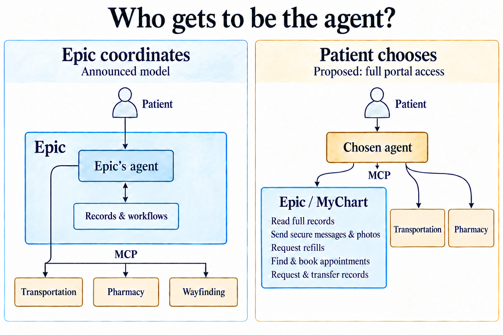

Epic just [announced "Connectors,"](https://www.fiercehealthcare.com/ai-and-machine-learning/epic-launches-connectors-link-its-ai-tools-third-party-apps) a framework that invites outside software developers to plug their services into Epic’s AI assistants using the Model Context Protocol (MCP). Testing begins late this year, with broader distribution through the Epic Showroom starting in March 2027.

On the patient side, Epic describes workflows where a patient can ask Epic’s MyChart assistant, Emmie, to order a hospital meal through a dietary app, pull directions from a wayfinding vendor, track prescription deliveries, or check the weather forecast and transportation options when booking a follow-up visit.

Epic says the goal is to keep Connectors "open and standards-based," but the architecture only points inward. Outside services become tools that Epic’s assistant can call, [positioning Emmie as the primary interface](https://stratechery.com/2018/the-bill-gates-line/) while drawing the surrounding ecosystem in as background utilities.

## The Asymmetry of Host vs. Tool

In the [MCP architecture](https://modelcontextprotocol.io/docs/learn/architecture), there is a foundational distinction between the **Host** (the application that holds the user interface, manages the conversation, and runs the MCP client) and the **Server** (the tool that responds when called).

With Connectors, Epic is implementing MCP for live workflows so that Epic’s application is the Host and everyone else is a Server. *(In today’s opening session at Open@Epic, Seth Howard also announced an MCP server for the public API documentation on [open.epic.com](https://open.epic.com/), going live by the end of the month—a nice addition for developers, though separate from live clinical or patient workflows.)*

When a patient asks Emmie where to park or when their discharge medications will arrive, the patient gets a more convenient experience inside MyChart, and Epic steps between the third-party service and the user. This sets up a [self-reinforcing loop](https://stratechery.com/2015/aggregation-theory/):

1. Outside developers build Connectors so they can participate in the workflows happening inside MyChart.
2. Each new Connector makes Emmie more capable, habituating patients to start tasks by talking to Epic’s assistant.
3. As user attention consolidates inside Epic's interface, third-party developers have less opportunity to reach patients directly, giving more of them reason to plug in as headless background tools.

In platform economics, this is how an aggregator [commoditizes its complements](https://www.joelonsoftware.com/2002/06/12/strategy-letter-v/). When we designed [SMART on FHIR](https://pmc.ncbi.nlm.nih.gov/articles/PMC4997036/), the goal was for the EHR to act as a foundational platform so outside applications could bring specialized intelligence and new user experiences to patients and clinicians. Today, patient-facing FHIR read access is decent for core clinical data, though it still leaves out parts of the full record and most interactive workflows. Connectors invert that platform relationship: outside services supply the backend capabilities, while Epic owns the user relationship and the glass.

## Where Hospital-Centered Coordination Stops

Turning fragmented services into tools that an AI agent can orchestrate is a genuine improvement. Jumping between different apps and portals—what Epic calls "swivel-chair" work—is exhausting. The limitation isn't that services are becoming tools; it's the assumption that the hospital's assistant should be the coordinator.

A hospital naturally wants services coordinated around its own operations: its kitchen, its hallways, and its discharge pharmacy. When a patient is lying in a hospital bed ordering lunch, routing that task through Emmie makes sense.

A patient’s life, however, does not happen inside one hospital’s instance of Epic. Consider Epic's example of an older adult booking a follow-up appointment while checking the weather and arranging a ride. In the real world, that patient is often coordinating with a daughter who works full-time, a cardiologist at a competing health system across town on a different EHR, and an independent retail pharmacy.

Making Epic's Emmie the agent that checks the weather and looks up transportation gets the gravity backward. A patient is much better served when they can use an agent of their own choosing—one that already holds their personal calendar, knows their family caregiver’s schedule, and connects to their everyday apps—to act as the orchestrator, calling Epic as a tool to search appointment availability and book the slot.

When every health system expects its own portal bot to be the master orchestrator, the patient's "swivel-chair" problem isn't solved; they just trade clicking through three different portals for talking to three separate portal bots. Even as Emmie adds more services, the patient should be able to choose their coordinator—and choosing another agent shouldn't mean losing access to MyChart’s capabilities.

## Defining Safety Around the Host Agent

Epic emphasizes that Emmie operates under strict human-in-the-loop guardrails backed by thousands of internal test cases, and that each health system’s security, legal, and compliance teams will review and approve every Connector before data flows. Clinical safety and local governance are vital, and health systems have good reason to vet the tools they plug into their infrastructure.

The risk is defining safe orchestration around Epic’s own assistant. If a patient-chosen agent seeking to book an appointment, message a clinic, or request a refill is treated as an unvetted risk by default, governance becomes a barrier that insulates the portal bot from alternatives.

## Supporting Patient Choice with Two-Way Access

Using MCP to pull third-party tools into MyChart is half of an open architecture. A truly patient-centered ecosystem works in both directions.

Alongside inviting outside developers to build MCP Servers for Emmie, Epic could expose the full range of MyChart capabilities as standards-based tools. Opening up complete record access, secure provider communications, refill requests, and appointment search and booking would allow patients to use the AI agents of their choice with the same depth of access that Epic grants its own.
