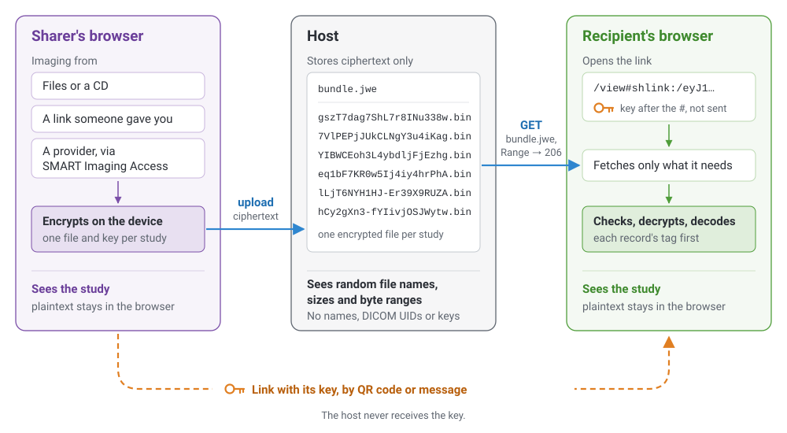
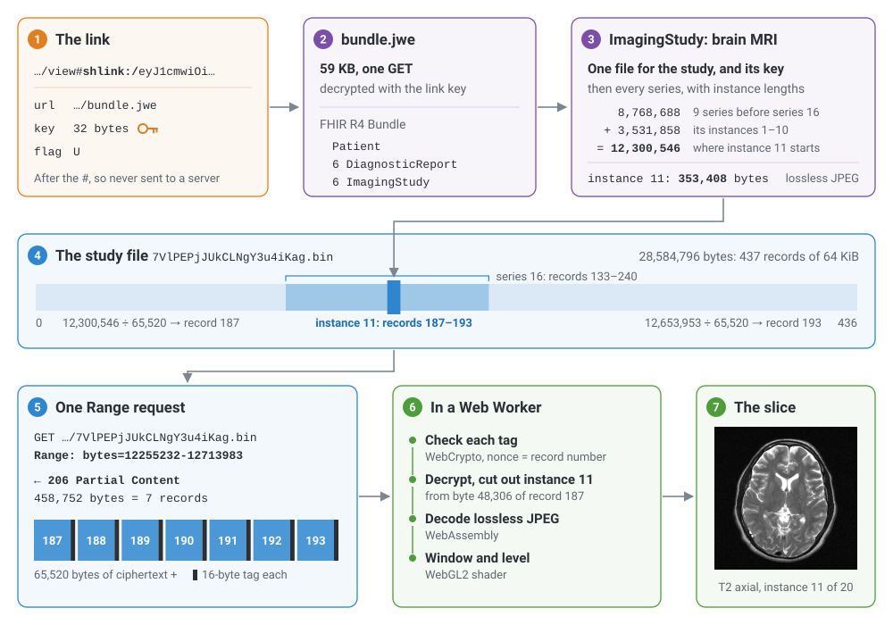
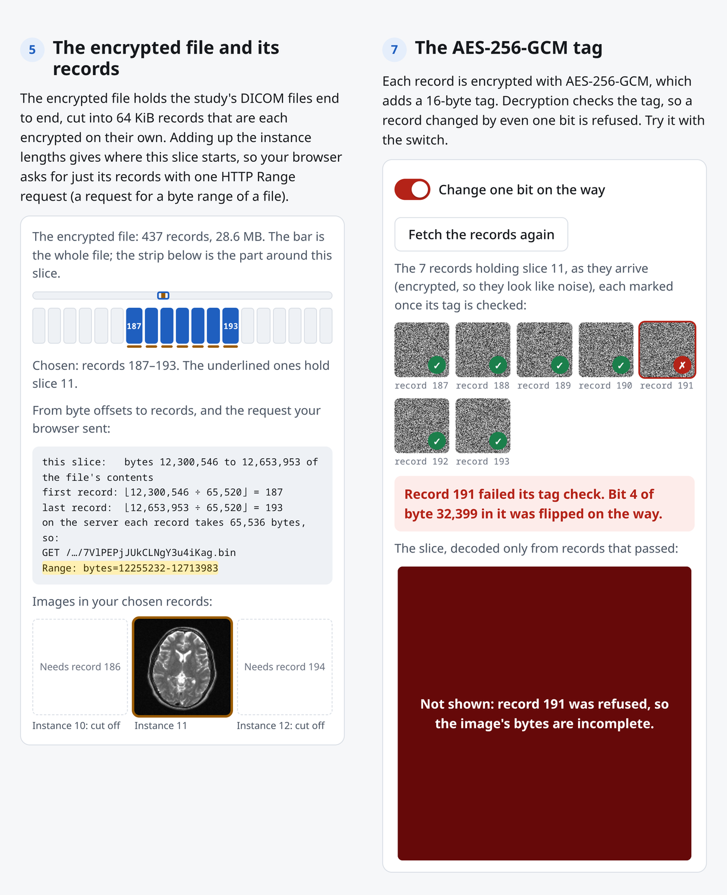
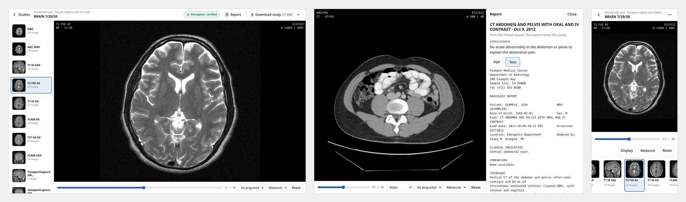
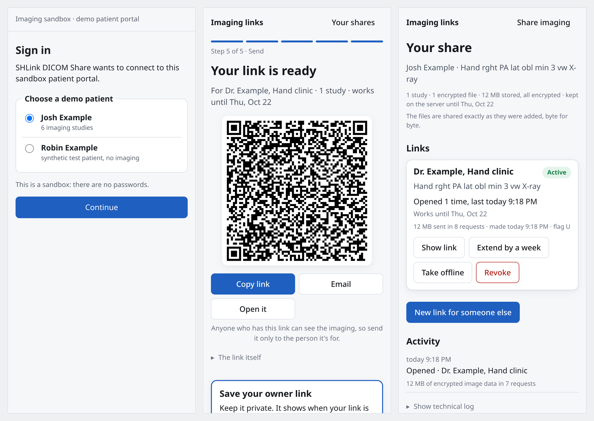
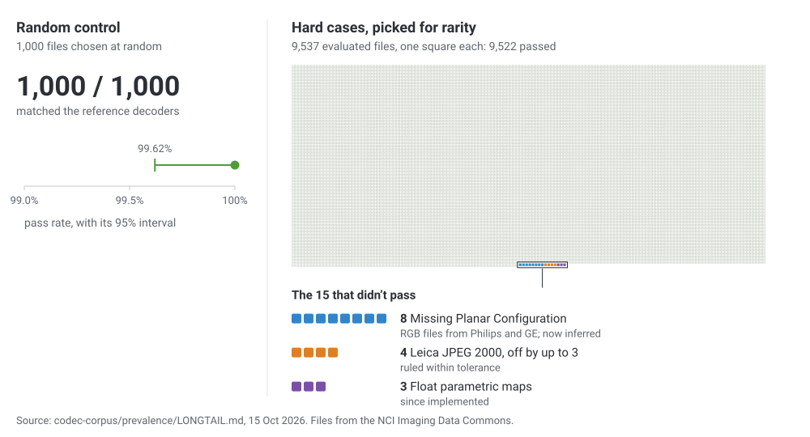
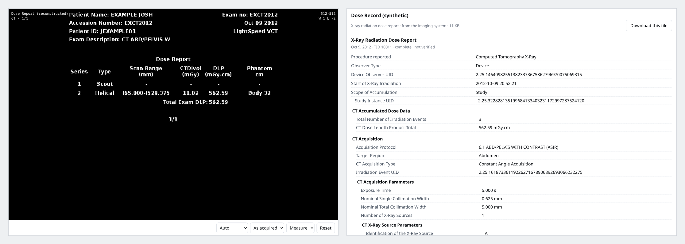
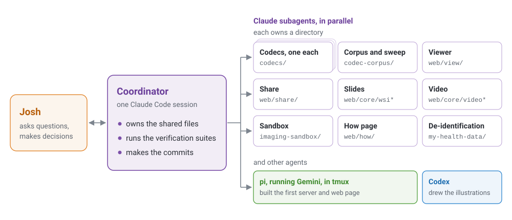

I'm an unusual patient: I publish my own health records in a public GitHub repository, imaging [EHI export](https://github.com/jmandel/my-ehi) included. Real clinical data is scarce, and developers building health software often never see a realistic example of the formats they're meant to handle. Putting mine in the open has let developers test their code against real FHIR, EHI, and DICOM content instead of toy examples. My brain MRI, my abdominal CT and three sets of hand and wrist X-rays are in my [health-data repository](https://github.com/jmandel/my-health-data/tree/master/imaging), de-identified as "Josh Example."

Most people don't want (and shouldn't put!) their scans in a public git repository. But many people *do* want their data under their control so they can... just do things, like: keep a lifetime archive that outlasts any one hospital, send a study across the country for a second opinion, show family what the radiologist was talking about, run risk calculators and AI on it, or donate it to research.

I helped create two standards that cover parts of this workflow: [SMART Health Links](https://build.fhir.org/ig/HL7/smart-health-cards-and-links/links-specification.html), which share records by link or QR code, and [SMART Imaging Access](https://build.fhir.org/ig/argonautproject/smart-imaging/), which lets patients use any app they choose to fetch their imaging from their providers through standard APIs. SMART Imaging Access gets imaging out of clinical systems; SMART Health Links let a patient pass it on to anyone at the application layer, so the network doesn't have to anticipate every sharing workflow. Until this week, it was hard to apply SMART Health Links for whole imaging studies, so I built "shlink-dicom": a draft profile showing how to give any app everything it needs to download a complete study, every DICOM file (and supporting imaging reports), automatically, with no one clicking through web pages. The same link also opens the study in any web browser. It's end-to-end encrypted, so the server hosting the files can't read the data. It's also the story of how I built it in under 24 hours with a team of AI coding agents, including image decoders written from scratch in Rust and checked against thousands of real files from the NCI Imaging Data Commons.

The demo runs on my own sample data, plus an openly licensed pathology slide to round out the picture. Open [the sample link](https://shlink-dicom.exe.xyz/sample) and tap the MRI, and you'll be scrolling through slices in under a second,[^1] though the whole share is 313 MB. The link demonstrates performant, private sharing: your browser fetches only the byte ranges it needs to draw and decrypts them locally, and the server holds only ciphertext.

> **Try it:** Open the [sample study](https://shlink-dicom.exe.xyz/sample), [share your own](https://shlink-dicom.exe.xyz/share) (from a folder, a CD, or my [sandbox provider](https://smart-imaging-sandbox.exe.xyz) through SMART Imaging Access), or see [how the protocol works](https://shlink-dicom.exe.xyz/how) on live bytes. The [specification](https://github.com/jmandel/shlink-dicom/blob/main/spec/README.md) and code are at [`jmandel/shlink-dicom`](https://github.com/jmandel/shlink-dicom).

***Architecture and trust.** Plaintext exists only on the sharer's and the recipient's devices. The host stores and serves ciphertext under random names; the key travels in the link and never reaches the host.*

## One study, traced from link to pixels

A SMART Health Link is a `shlink:/` URI, often shown as a QR code, whose encoded payload includes a 32-byte key. Ours are viewer links: the `shlink:/` part follows a viewer's web address after the `#`, and browsers never send that part of a URL to the server, so the key stays in your browser. In a standard SMART Health Link, the key opens an encrypted file (a JWE) holding a FHIR Bundle.

A single JWE doesn't suit imaging. It's base64url-encoded, which incurs a 33% file size tax, and it's sealed with one AES-GCM tag at the very end, so the whole file has to be downloaded, held in memory and decrypted in one piece before any of it can be checked or shown. shlink-dicom keeps the link and the Bundle completely standard and puts the images beside them:

***From link to pixels.** One slice of the sample MRI (series 16, T2 FSE AX, instance 11 of 20), with the real numbers from the live sample link: one Range request for 7 of the study file's 437 records.*

1. **FHIR Bundle arrives first.** Your browser fetches `bundle.jwe` (59 KB for the sample) and decrypts it with the link's key. Inside is an ordinary FHIR R4 Bundle: the patient, a report for each study, and an `ImagingStudy` for each study.
2. **`ImagingStudy` is the index.** It lists every series and instance in order. Two FHIR extensions carry the byte map: one names the study's encrypted file by a random id and gives its random 32-byte key, and the other records the byte length of each DICOM instance. Adding up the lengths of everything listed before an instance gives the offset where it starts in the file.
3. **Offsets map to 64 KiB records.** Beside the Bundle sit the encrypted files, one per study: the study's DICOM files laid end to end, cut into records of 65,520 bytes of plaintext plus a 16-byte AES-256-GCM tag, exactly 64 KiB each. The nonce for record *i* is just the number *i*; each file has its own random key, so a record moved to another position or another file fails its tag check.
4. **One Range request pulls the slice.** The browser divides the slice's byte range by 65,520 to find the first and last records, multiplies by 65,536, and sends a single `Range: bytes=…` request. The server answers `206 Partial Content` with just those records.
5. **Client checks each record before using it.** Each record's tag is verified before any of its bytes are used, so a client can decode and show a slice as soon as its records arrive. My viewer does this in a Web Worker with WebCrypto, then decodes in WebAssembly and displays with WebGL2.

Nothing in those steps depends on my viewer, or on a browser at all. Any client that can make HTTP requests and decrypt AES-GCM, (e.g., a PACS importing a study, a research pipeline or a personal download script) can follow a SMART Health Link using these same steps. The [reference receiver](https://github.com/jmandel/shlink-dicom/blob/main/web/how/receiver.js) is about 60 lines of `fetch` and WebCrypto, and the specification includes a test vector to check an implementation against.

Opening the sample MRI this way, the browser fetches about 1.5 MB, including the 59 KB Bundle, by the time the first slice is drawn; the share as a whole is 313 MB in six encrypted files, one per study.

The storage host sees a request for `bundle.jwe` and a handful of byte range requests against random file names. It never sees a patient name, a DICOM UID or a key. If a broken server or proxy alters a byte, reorders records, or truncates a file, the tag check or the length check from the Bundle fails and the record is refused. The [How it works](https://shlink-dicom.exe.xyz/how) page shows all of this on the sample link, including a switch that flips a bit in transit so you can watch the record get rejected.

***The How it works page.** Left: the MRI's encrypted file is 437 records of 64 KiB; adding up instance lengths puts slice 11 in records 187–193, fetched with one request, `Range: bytes=12255232-12713983`. Right: one bit flipped in transit, so record 191 fails its tag check and the slice is not shown.*

## What a recipient sees

The protocol doesn't need any particular viewer, but a link is only useful to most people if it opens on whatever device they have in hand, without installing anything. So I built a default viewer experience that starts with an overview with each study's report summary, then opens each CT or MR on its largest axial series. Window and level adjustments run on the GPU, and any series that forms a volume can be shown in other planes. (They're resampled in patient space, including oblique planes and slabs.)

***The sample MRI and CT on desktop and phone.** The T2 axial MRI with its series strip, and the abdominal CT with its report side by side (1440×900), plus the phone layout (390×844).*

Reports rarely travel inside the DICOM files. In health systems they typically live on the clinical side, as FHIR DiagnosticReports. When a study comes from a provider through SMART Imaging Access, shlink-dicom puts those reports into the Bundle beside the `ImagingStudy` and shows them next to the images, labelled with where each came from. Structured reports such as the CT's radiation dose record, encapsulated PDFs, segmentations, waveforms and cine loops are shown too.

To test the streaming model at the extreme end of imaging, I also built a deep-zoom viewer for whole-slide pathology, and the sample includes a lung slide from IDC (CC BY, from a different person, relabelled). The viewer reads the slide's layout and fetches only the tiles on screen. On the full 1.2 GB original of that slide, zooming into tissue and panning around fetched about 1% of it.[^2]

And because the point is keeping the real data, **Download study** writes a standard ZIP with a DICOMDIR containing the DICOM files in the share. Every pixel value is exactly what the scanner recorded. (Images the viewer made, like reformats, are not offered as files.)

## Sharing your own imaging

The [share page](https://shlink-dicom.exe.xyz/share) can ingest data from three sources: files or a CD folder on your device, a SMART Health Link someone gave you, or a healthcare provider API (fetched through SMART Imaging Access).

To test that path end to end, I built a standalone [sandbox provider](https://smart-imaging-sandbox.exe.xyz) that implements the draft [SMART Imaging Access](https://build.fhir.org/ig/argonautproject/smart-imaging/): an authorization server with PKCE and a consent page where you can leave out individual studies, a clinical FHIR server with Patient and DiagnosticReport, an imaging FHIR server with `ImagingStudy`, and a DICOMweb WADO-RS server that accepts the same access token. Building a strict server and client turned up places where the draft SMART Imaging Access guide was unclear. Two are filed as issues ([#2](https://github.com/argonautproject/smart-imaging/issues/2), on the token response example, and [#3](https://github.com/argonautproject/smart-imaging/issues/3), on transfer-syntax negotiation), and I opened a pull request ([#5](https://github.com/argonautproject/smart-imaging/pull/5)) so apps can ask a server for lossless compressed images first, with "as stored" as the fallback.

***Sharing from the sandbox provider on a phone.** Signing in as Josh Example on the sandbox, the hand-over QR code, and the owner page with open counts and revoke (390×844).*

Many files a patient brings are uncompressed; DICOM's CD profile requires it. By default, the share page re-encodes those images to lossless JPEG in the browser before encrypting them, with an encoder I wrote in Rust for this. It decodes each result again and checks every pixel before upload, and every other header value stays the same. On my five studies the files shrank from 403 MB to 164 MB, about 2.5×. Anyone who needs the original bytes can choose "Keep files exactly as they are."

Once you pick the studies, your browser compresses and encrypts them on your device and uploads them a piece at a time, so memory stays flat however large the study is. When the connection drops, the client asks the server how much it already has and picks up from there, following the IETF's resumable upload draft.

When the upload finishes you get a SMART Health Link to share (with an optional passcode and an expiry of up to 31 days) and a private owner link to manage sharing over time. There are no user accounts. Because each study's file has its own random key, stored only inside the link's Bundle, you can later use the owner link to make a new link for a physical therapist that contains only your wrist X-ray. That means encrypting a new `bundle.jwe` with just that study's key, without re-encrypting or re-uploading any image bytes. The owner page also shows how often each link was opened and lets you revoke it, after which it returns 404.

## Writing our own decoders, and knowing they're right

A web viewer that opens any study a patient brings, from any hospital, on any phone, runs straight into DICOM in the wild: dozens of pixel encodings and colour models, and real files that bend the rules in creative ways. Most web viewers compile several C and C++ libraries to WebAssembly to cope. Early on I asked the coordinating agent, "How much progress could we make with pure rust / zero deps, with a frontier agent and a pile of examples to test against known-good decoders?" The answer turned out to be all the still-image encodings in the standard that actually contain pixels: uncompressed, RLE, every JPEG mode (8- and 12-bit, lossless, progressive, arithmetic, hierarchical), JPEG-LS, JPEG 2000 (Parts 1 and 2), HTJ2K, JPEG XL, and float pixel data, all in Rust compiled to WebAssembly. Every decoder was written from scratch, with no third-party codec libraries. Video goes to the browser's own player, or for old MPEG-2 to an LGPL decoder whose source is served alongside it. The details are in the [codecs workspace](https://github.com/jmandel/shlink-dicom/tree/main/codecs).

Before any agent wrote decoder code, the coordinator built a [test corpus](https://github.com/jmandel/shlink-dicom/tree/main/codec-corpus) and a harness around independent reference decoders (pydicom with its plugins, GDCM, DCMTK, CharLS, OpenJPEG and OpenJPH). For lossless encodings of my own synthetic seed images, the seed pixels are the ground truth, so no decoder has to be trusted. For everything else the references vote, and two wrappers around the same C library count as one vote. Several disagreements turned out to be bugs in the references. pydicom applies Planar Configuration to JPEG output, where the standard says it doesn't apply, which scrambles the colour. On Leica slides with subsampled JPEG 2000 colour, a profile with 23,729 instances in IDC, OpenJPEG converts the colour once and pydicom converts it again. Each of these is recorded as a written ruling with its evidence, and the check runs against a repaired copy of the file.

I also tested against real archives. From the NCI Imaging Data Commons, an agent picked thousands of files to cover the rarest combinations of manufacturer, software version and transfer syntax, plus 1,000 chosen at random. All 1,000 random control files matched the reference decoders. Fifteen of the hard cases didn't, for three reasons: float parametric maps, which I then implemented; small rounding differences on subsampled Leica JPEG 2000 slides, ruled acceptable within 3; and eight RGB files from Philips and GE missing Planar Configuration, which the decoder now infers from pixel smoothness.[^3] The full write-up is in [`LONGTAIL.md`](https://github.com/jmandel/shlink-dicom/blob/main/codec-corpus/prevalence/LONGTAIL.md).

***The IDC sweep.** Left: the random control, 1,000 of 1,000 passing, with its 95% interval. Right: the 9,537 evaluated hard cases, one square each, with the 15 that didn't pass coloured by cause. The sweep picked rare cases on purpose; the random control shows the typical file. Source: [`LONGTAIL.md`](https://github.com/jmandel/shlink-dicom/blob/main/codec-corpus/prevalence/LONGTAIL.md), 15 Oct 2026.*

## De-identifying my own scans: synthesize, don't drop

A demo built on toy data hides the friction of real clinical exports. I started the sandbox with a fictional patient, then switched to something simpler and more honest: my own five studies, published as Josh Example with names and identifiers replaced, the birth date cut to the year and the study dates kept, plus the CC BY lung slide.

Running a tag stripper isn't enough for real hospital exports. The first de-identification pass on my CT and MRI dropped six series (a CT dose screen, a scanned paper order form and four screen captures from the MRI viewer) because my real name and birth date were burned into the pixels. I pushed back: "Rather than dropping data from my report, please create a synthetic equivalent… to maintain verisimilitude." A script, [`reconstruct.py`](https://github.com/jmandel/my-health-data/blob/master/imaging/reconstruct.py), redrew each of them with the same layout and values under the Josh Example identity, marked "(reconstructed)", and the dose values also became a DICOM radiation dose structured report. Then, before anything was pushed, the coordinating agent read every remaining header value, searched every file for my real name, birth date and record numbers (reading them from the private source at run time so they never touched git), looked at the full-resolution X-rays for ID flashes, and caught one place where the first pass had left my real health insurer's name on the rebuilt order form.

***The reconstructed dose screen.** The rebuilt CT dose screen beside the synthetic dose structured report in /view.*

## How I built it

I started this on the afternoon of October 14, 2026, as an aside in a Claude Code session (Claude Opus 5.5) about another project. My first prompt was: "are you familiar with smart health links? Read the spec." I had a working version deployed in under 24 hours.[^4]

I used that session as the coordinator. It owned the shared files, ran the test suites and made the commits. Over the project it launched 42 Claude subagents, each working in its own directory: one per codec, others for the IDC sampling and the long-tail sweep, one each for the viewer, sharing, slides, video and the sandbox, and two independent reviewers before the last merges. A session of the pi coding agent running Gemini (gemini-4-argon) in a tmux pane built the first version of the server and web page, and Codex drew the illustrations.

***Who did what.** The coordinator owned the shared files, ran the verification suites and made the commits; each subagent owned its own directory.*

Most of my design input was short questions that removed parts of early drafts of the protocol. The first draft wrapped each series in a ZIP archive split into custom segments, added optional compression, derived keys with HKDF and marked the final record of each file:

- **"What's the zip buying us?"** Nothing the offsets in the `ImagingStudy` and the GCM tags didn't already provide, so the encrypted files became the DICOM instances laid end to end.
- **"I don't love optionality here, how does a client even know what's deflated."** I dropped the optional compression. Image compression already lives inside the DICOM files, and every client has one code path.
- **"Final record delimiter… why is that needed? Doesn't ending at that point also accomplish the same?"** I dropped the delimiter. The authenticated Bundle gives every instance's length, so a client knows the exact file size and detects truncation from that.
- **"Why use HKDF at that point?"** Once each file had its own random key inside the link's Bundle, I dropped key derivation.

The same kind of question came up with whole-slide pathology. Many slides in IDC leave DICOM's Basic Offset Table empty, so the slide subagent prototyped a FHIR Bundle extension to carry tile offsets. I asked: "Is this suggestion only to rescue slides that lack metadata that could be present in DICOM?" It was, so I dropped the extension and had the packer write the standard offset table into each file when a share is created, leaving the compressed tiles untouched. On test slides without the table, that cut the data needed for the first full-resolution screen from hundreds of megabytes to a few.[^5]

## Where this goes next

I think it would be very interesting to bring this approach into the standards ecosystem as part of the HL7 [SMART Health Cards and Links](https://build.fhir.org/ig/HL7/smart-health-cards-and-links/) implementation guide. If you build systems that touch medical imaging, here's where your feedback or adoption would matter most:

- **Imaging providers and their vendors:** implement [SMART Imaging Access](https://build.fhir.org/ig/argonautproject/smart-imaging/) so patients can use any app they choose to pull their studies, reports and original files through standard APIs, without burning a CD, and be ready to send lossless compressed images when an app asks for them. When you export multi-frame images or slides, fill in the offset tables so streaming viewers don't have to read hundreds of megabytes of headers.
- **Imaging systems and research tools:** accept a `shlink:/` link as an import source and pull the full study with no one at a browser.
- **Web viewer developers:** a receiver takes about 60 lines of plain `fetch` and WebCrypto ([`receiver.js`](https://github.com/jmandel/shlink-dicom/blob/main/web/how/receiver.js)). I'd love to see `shlink:/` support in open-source viewers, and anyone is welcome to use or adapt the decoders or check their own against the [corpus](https://github.com/jmandel/shlink-dicom/tree/main/codec-corpus).
- **Standards implementers:** look at the open questions in [§15 of the specification](https://github.com/jmandel/shlink-dicom/blob/main/spec/README.md#15-open-questions), especially whether a link like this still counts as a Plain SMART Health Link, and tell me what breaks in your environment.

Both sites, [shlink-dicom.exe.xyz](https://shlink-dicom.exe.xyz) and the [SMART Imaging sandbox](https://smart-imaging-sandbox.exe.xyz), are tech demos, and you're welcome to play with them. Grab the code, open the sample on your phone, or point the share page at a DICOM folder of your own.

- [Live site](https://shlink-dicom.exe.xyz)
- [Sample study](https://shlink-dicom.exe.xyz/sample)
- [share your own](https://shlink-dicom.exe.xyz/share)
- [how it works](https://shlink-dicom.exe.xyz/how)
- [SMART Imaging sandbox](https://smart-imaging-sandbox.exe.xyz)
- [Code and spec](https://github.com/jmandel/shlink-dicom)
- [Specification](https://github.com/jmandel/shlink-dicom/blob/main/spec/README.md)
- [Sample imaging data](https://github.com/jmandel/my-health-data/tree/master/imaging)

[^1]: Measured 15 Oct 2026 with headless Chromium (1440×900, empty cache) on my desktop, over a home connection with about 10 ms round trip to the server; median of 3 runs. The study overview with its first thumbnail appeared 0.56 s after the page started loading; the first T2 slice was drawn 0.13 s after clicking the MRI (0.68 s after the page started loading, since the script clicked as soon as the overview appeared). The MRI is 28.6 MB of the share's 313.4 MB. The link is `https://shlink-dicom.exe.xyz/sample`, which redirects to the current sample link.

[^2]: Sample slide: CPTAC-LUAD (CC BY 4.0), reduced to three levels and 152.3 MB; its most detailed level is 18,425 × 11,712 pixels at about 2 µm per pixel, in 240×240 JPEG tiles. Viewing its centre at full resolution took 7.4 MB (4.8%) on desktop and 5.4 MB on a phone (`share-checks.mjs --only=slide`). Original slide: 1,206 MB with its base level; a desktop session that zoomed into tissue and panned six times fetched 14.6 MB (1.21%) in 175 requests, and a phone view at full resolution fetched 5.9 MB (0.49%). Measured against a local server in headless Chromium; see [`web/view/WSI.md`](https://github.com/jmandel/shlink-dicom/blob/main/web/view/WSI.md).

[^3]: NCI Imaging Data Commons, which lists 58.8 million DICOM instances in BigQuery. The long-tail sweep chose 9,557 instances covering rare values across 118 manufacturers, 425 scanner models and 1,042 software versions, plus a uniform random control of 1,000. Random control: 1,000 of 1,000 passed (95% interval 99.62%–100%). Long tail: 9,522 of the 9,537 that could be evaluated passed, with no crashes. The test corpus now has 1,176 cases, all passing.

[^4]: From the first commit (14 Oct, 3:13 pm Central) to the deployed coverage round (15 Oct, about 1 pm), per the git history. Subagent count from the coordinator's session records (42 subagent transcripts as of 15 Oct, evening).

[^5]: Bytes to the first full-resolution screen on three test slides, before and after adding offset tables: 135 MB → 3.7 MB, 128 MB → 3.2 MB, 379 MB → 6.6 MB ([`web/view/WSI.md`](https://github.com/jmandel/shlink-dicom/blob/main/web/view/WSI.md)).

